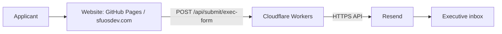

# OSDev Email Backend

Receives executive applications from the SFU Open Source Development Club website and emails them to the club's executives.

This README describes the roadmap for migrating the existing Python/FastAPI backend to **Cloudflare Workers + Resend**, while retaining Docker for local testing.

> Migration plan: the proposed `worker/` project and deployment steps below are not implemented by this README. The existing Python service remains available during the transition.

## Target architecture



| Component | Responsibility |
| --- | --- |
| GitHub Pages | Hosts the existing website and application form. |
| Cloudflare Workers | Provides the API endpoint, validates input, formats applications, and requests email delivery. |
| Resend | Sends emails and reports delivery events. |
| Docker Compose | Runs the existing Python backend locally for testing and comparison. |
| Wrangler | Runs and deploys the actual Worker code. |

Production does not require a personal computer or Docker container to stay running. The Worker processes incoming requests and calls Resend. A separate application database is outside the scope of this migration.

## Planned repository structure

```text
Email-Backend/
├── main.py                    # Existing FastAPI entry point
├── routers/
├── services/
├── tests/                     # Existing Python tests
├── Dockerfile
├── compose.yaml
├── .env.example               # Existing SMTP configuration example
└── worker/                    # Planned Workers project
    ├── src/
    │   └── index.ts           # Application API, validation, Resend integration
    ├── tests/                 # Validation and email integration tests
    ├── package.json
    ├── package-lock.json
    ├── tsconfig.json
    ├── wrangler.jsonc
    ├── .dev.vars.example
    └── .gitignore
```

## Migration roadmap

### Phase 1: Create the Workers project

- [ ] Create a TypeScript Worker in `worker/`.
- [ ] Configure Wrangler development and deployment commands and a test runner.
- [ ] Ignore `node_modules/`, `.wrangler/`, `.dev.vars`, and `.dev.vars.*` in Git.
- [ ] Add an exception so `.dev.vars.example` can be committed.

From the repository root, start the project generator:

```powershell
npm create cloudflare@latest -- worker
```

Choose a TypeScript Worker. Adjust the proposed structure and commands to match the generated project.

### Phase 2: Port the application endpoint

- [ ] Preserve `POST /api/submit/exec-form`.
- [ ] Preserve the JSON field names used by the website.
- [ ] Validate name, email, student ID, year of study, faculty, major, Co-op status, and selected team.
- [ ] Support Technology and Event team questions.
- [ ] Include personal information and every relevant question and answer in the email.
- [ ] Set Reply-To to the applicant's email address.
- [ ] Return consistent JSON errors for invalid input and email provider failures.
- [ ] Handle CORS preflight requests and allowed origins.

Resolve these existing behaviors during migration:

- Accept the website's `5+` year-of-study value.
- Confirm whether the club wants to retain the policy rejecting applicants on a Co-op term.
- Prevent answers from a previously selected team from being submitted with another team.

CORS controls browser access; it is not authentication or spam protection. Before public release, implement request-size and field-length limits, submission rate limits, and bot protection such as Turnstile.

### Phase 3: Configure Resend

- [ ] Create a club-managed Resend account.
- [ ] Register `sfuosdev.com` or a dedicated sending subdomain.
- [ ] Add the DNS records supplied by Resend and verify the sending domain.
- [ ] Create an API key for sending emails.
- [ ] Confirm the sender address and executive recipients.

Example sender: `OSDev Applications <applications@sfuosdev.com>`.

Recipients can continue using their existing Gmail inboxes. The Resend implementation does not use Gmail SMTP app passwords.

### Phase 4: Develop and test locally

Store local Worker configuration in `worker/.dev.vars`. Commit only placeholders in `.dev.vars.example`:

```dotenv
RESEND_API_KEY=replace_with_local_test_key
EMAIL_FROM="OSDev Applications <applications@sfuosdev.com>"
EMAIL_TO=recipient@example.com
ALLOWED_ORIGIN=http://localhost:5173
```

`ALLOWED_ORIGIN` is a proposed application setting. The Worker must explicitly read it and implement the corresponding CORS behavior.

After creating the Worker project and installing its dependencies:

```powershell
cd worker
npx wrangler dev
```

Set the website's `.env.development.local` to the URL printed by Wrangler, then restart Vite:

```dotenv
VITE_LOCAL_ENDPOINT=http://localhost:8787
```

The current frontend prioritizes `VITE_ENDPOINT` over `VITE_LOCAL_ENDPOINT`. Check both settings when switching between local and production APIs.

- [ ] Confirm that the local website reaches the Worker API.
- [ ] Mock the email provider in automated tests so no real emails are sent.
- [ ] Verify that personal information and all questions and answers appear in the email body.
- [ ] Test missing fields, team changes, `5+`, Co-op policy, and provider failures.
- [ ] Test allowed and blocked origins and OPTIONS responses.
- [ ] Send an intentional test application to a designated recipient and confirm delivery.

Local execution with `wrangler dev` does not automatically block external requests. Running the sending code with a real Resend key can send real emails.

Keep the existing Python/Docker environment available separately:

```powershell
# From the repository root: run the existing Python backend
 docker compose up --build -d
 docker compose exec -T api python -m pytest -q
```

Passing Python tests does not validate the Worker implementation. A Docker-based test inbox can be added later, but routing the Worker's Resend HTTPS calls to it requires a separate test delivery adapter.

### Phase 5: Deploy the Worker

- [ ] Prepare the Cloudflare account and Worker configuration.
- [ ] Configure production `EMAIL_FROM`, `EMAIL_TO`, and `ALLOWED_ORIGIN`.
- [ ] Set the production allowed origin to `https://sfuosdev.com`.
- [ ] Register the Resend API key as a Cloudflare secret.
- [ ] Deploy and record the public HTTPS endpoint.

From `worker/`:

```powershell
npx wrangler login
npx wrangler secret put RESEND_API_KEY
npx wrangler deploy
```

Manage production configuration through Wrangler or the Cloudflare dashboard. Values in `.dev.vars` are local and are not automatically deployed as production settings.

Never put the Resend API key in source code, public configuration, or the website's `VITE_*` variables.

### Phase 6: Connect the production website

- [ ] Set `VITE_ENDPOINT` in the website's production build environment.
- [ ] Rebuild and deploy the website to GitHub Pages.
- [ ] Submit a test application from the actual domain and confirm executive email delivery.

```dotenv
VITE_ENDPOINT=https://YOUR-WORKER.YOUR-SUBDOMAIN.workers.dev
```

Use the base URL without the API path. The current website appends `/api/submit/exec-form`.

Vite embeds environment variables at build time, so changing the endpoint requires a new website build and deployment. Running Docker locally does not switch the production website to the new backend.

### Phase 7: Prepare ongoing operations

- [ ] Document club ownership of the Cloudflare account, Resend account, DNS, and recipient configuration.
- [ ] Document how to investigate Worker errors and Resend delivery failures.
- [ ] Monitor free request and email quotas.
- [ ] Prevent duplicate submissions and handle retries without duplicate emails.
- [ ] Avoid logging secrets or complete applications containing personal information.

A successful API response means Resend accepted the send request. It does not guarantee inbox delivery or that the recipient opened the message. Use Resend delivery events to investigate final delivery status.

## Definition of done

The migration is complete when an application submitted from `sfuosdev.com` passes Worker validation and reaches the designated executives with the applicant's personal information and all relevant questions and answers.

Keep the existing Python/Docker environment for local testing and comparison until that verification is complete.

## Official documentation

- [Cloudflare Workers getting started](https://developers.cloudflare.com/workers/get-started/guide/)
- [Wrangler commands](https://developers.cloudflare.com/workers/wrangler/commands/)
- [Local environment variables and secrets](https://developers.cloudflare.com/workers/local-development/environment-variables/)
- [Sending emails with Workers and Resend](https://resend.com/docs/send-with-cloudflare-workers)
- [Resend domain verification](https://resend.com/docs/dashboard/domains/introduction)
- [Workers limits](https://developers.cloudflare.com/workers/platform/limits/)
- [Resend pricing and free limits](https://resend.com/pricing)

Free operation depends on staying within each provider's current limits. Existing domain renewal costs are separate. Check the official limits and policies before launch.
